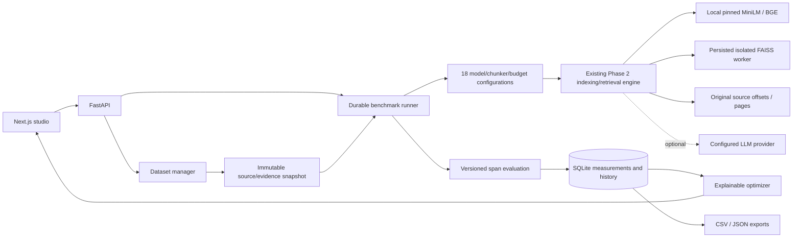
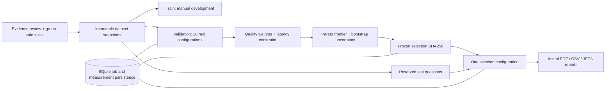

# RAGLab architecture

RAGLab retains the Next.js / TypeScript / Tailwind / Framer Motion / Recharts frontend and FastAPI / SQLite / PyMuPDF / sentence-transformers / FAISS backend. The additions extend the Phase 2 engine; they do not replace the existing models, indexing, chunking, playground or source viewer.

## Modules

| Module | Responsibility |
|---|---|
| `apps/api/main.py` | Existing API/upload/preferences routes and service wiring |
| `chunking.py` | Existing fixed, sentence and semantic source boundaries |
| `embeddings.py` | Existing pinned model revisions, query formatting and tokenizer-safe spans |
| `pipeline.py` | Existing embedding cache, persistent FAISS artifacts, indexing lifecycle, retrieval and sources |
| `generation.py` | Existing optional grounded provider adapter and quote validation |
| `datasets.py` | CSV/JSON import, editable judgments, review attestations and source validation |
| `evaluation.py` | Pure, versioned retrieval metrics, exact match, aggregation and optimizer |
| `benchmarks.py` | Durable 18-configuration run orchestration, resume, history and export |
| `dataset-manager.tsx` | Dataset editor, Unicode-aware source selection and human review workflow |
| `benchmark-center.tsx` | Run builder, actual progress, run history, heatmap, filters and leaderboard |
| `benchmark-charts.tsx` | Lazily loaded charts of measured results |

## Data and execution boundaries

SQLite stores source text/pages, saved experiments, vector-index provenance, embeddings, retrieval/answer snapshots, datasets, immutable benchmark snapshots, configuration statuses and individual measurements. Model weights, SQLite files, source uploads and generated indexes are runtime data and must not be committed.

One existing indexing worker builds FAISS artifacts; one benchmark worker orchestrates configurations and queries. The benchmark uses the same real retrieval engine as the Playground. FAISS remains in a subprocess to avoid Torch/OpenMP conflicts. Warm-ups use the same retrieval path without creating benchmark measurements or normal retrieval history.

A completed per-question measurement has a unique `(config_id, question_id, repetition)` key. Cancellation preserves committed work. Resume validates exact source hashes and pinned model metadata, skips completed configurations and existing measurements, and reruns only missing work. A completed run is immutable; repeat it as a new run. Dataset edits increment revision and do not mutate earlier run snapshots.

Failures retain actionable state and remain excluded from ranking. Null means unavailable/unmeasured; zero means an actual measured zero. Review status, answerability, sample size, model versions, thresholds, seed and cache policy travel with exports.

## Deployment boundary

This is a local, single-user research application. Use one FastAPI worker. Authentication, tenancy, distributed scheduling, OCR and production secrets management are Phase 4/deployment concerns. Optional generation sends the question and retrieved excerpts to the configured provider; local retrieval and benchmarking do not require external API credentials.

## Phase 4 extension

Adaptive orchestration has its own single-thread executor; it waits on the existing benchmark executor, which delegates indexing to the existing index executor. This avoids a job waiting for itself. Cancellation is cooperative. SQLite adds `adaptive_searches` and unique `adaptive_test_reservations`; existing tables and artifacts remain in place. Dataset split/group fields live inside the existing question JSON, with legacy questions treated as unassigned. Search snapshots and selected-config seals are immutable provenance. Restart marks in-flight jobs interrupted; resume checks original sources and pinned model registry. PDF generation uses local ReportLab vector graphics over persisted measurements.

## Research/editorial extension

```mermaid
flowchart LR
    Browser[Editorial studio + optional pipeline tour] --> Guard[Body and origin boundaries]
    Guard --> API[Existing FastAPI services]
    API --> PDF[Bounded PDF subprocess]
    API --> Evidence[Evidence decisions]
    Evidence --> Audit[(Append-only review events)]
    Audit --> Snapshot[Immutable snapshot + audit event IDs]
    API --> Existing[Existing FAISS / embedding / benchmark engine]
    Snapshot --> Existing
    Existing --> Answer[Real optional provider adapter]
    Answer --> Human[Explicit human claim rubric]
    Human --> Reviews[(Append-only answer reviews)]
    Reviews --> Reports[Separate as-of summaries in JSON / PDF]
    Existing --> Reports
```

`boundaries.py`, `ingestion.py` and `pdf_extract.py` bound upload work. `answer_reviews.py` stores explicit human judgments; `comparisons.py` enforces descriptive run compatibility. The browser's optional experience modules are lazy-loaded and reuse actual API data. Motion preferences are shared through context and persisted in existing workspace settings. New review tables do not alter existing source text, model versions, vector caches, index IDs or historical measurement payloads.
