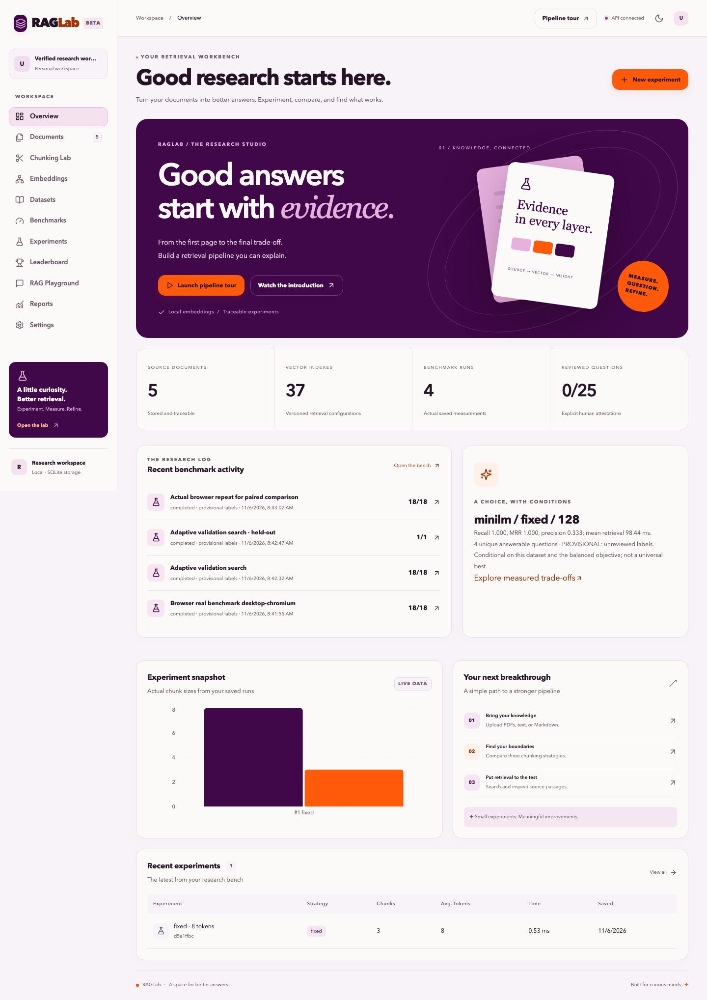
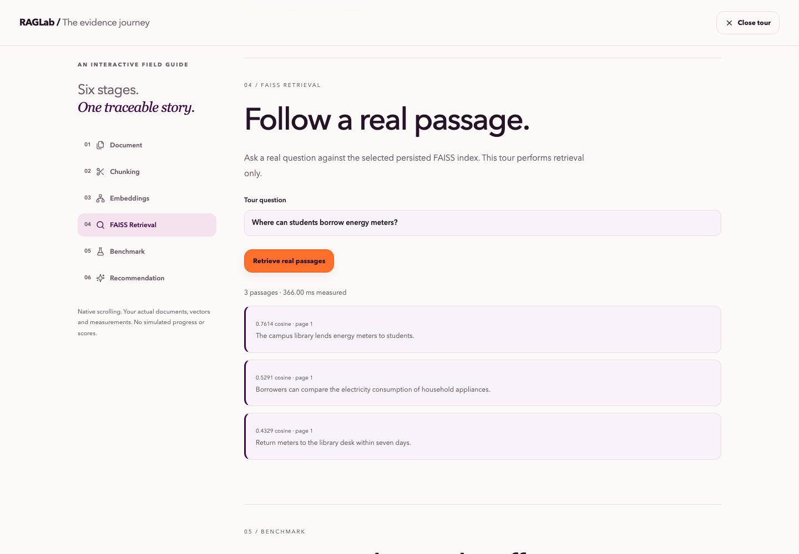
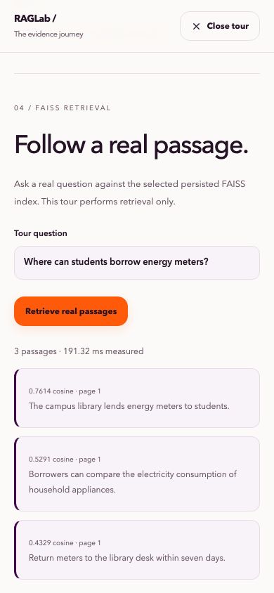

# Research/editorial verification - 2026-11-06

This continues main `5db4acf248eb63ab3cb528769afb31ea2c2f0f8b` with preserved history and additive changes. Verification used isolated public CC0 sample databases; no private runtime artifacts were published or reset.

| Area | Result | Evidence |
|---|---|---|
| Prior features and backend validation | PASS | 73 backend tests, including all 61 prior regression tests; 12 review/security/comparison cases |
| Production frontend and types | PASS | Next.js production build and TypeScript checks |
| Desktop/mobile workflows | PASS | 22 tests; 0 failed, skipped or flaky cases; final run 188.04 seconds |
| Accessibility and responsive bounds | PASS for exercised states | All 11 pages in light/dark on desktop/mobile; axe-core/playwright 4.14.0; keyboard scrolling, native modal Escape/focus, vector selection and reduced motion |
| Evidence review and research provenance | PASS | Approve/reject/reopen, revision conflicts, content/identity invalidation, append-only history, imported-flag reset, frozen audit IDs, compatible rerun comparisons |
| Provider adapter and human rubric | PASS in controlled tests | Sanitized provider probes, bounded 429 retry, timeout behavior, citation contracts, explicit human scoring and review history |
| Live provider generation | NOT TESTED | No valid server provider model/credentials configured; no generated answers or semantic scores are invented |
| Security/reliability checks | PASS for implemented bounds | Body/origin/file validation, subprocess timeout/decoded-stream limits, parser saturation, queue backpressure, CSV formula safety, index integrity and restart probe |
| Docker/public hosting | NOT TESTED / NOT DEPLOYED | Docker unavailable; no public deployment created; native setup, Compose and persistent-backend architecture documented |

Automated accessibility checks are not a complete WCAG certification. Security tests are not a penetration-test certification. Human-answer UI is available conditionally for real stored generation/abstention; its API/rubric contracts are tested with explicit controlled fixtures, while live-provider coupling remains unverified without credentials.

## Actual representative model execution

- Search: `72a60f85-d1f5-44c1-a7ed-c4df35dae36e`.
- Validation run: `78b56ee8-4464-4a44-9d4d-c6cb6841b9d6`: 18 configurations x 4 unique questions x 2 repetitions = **144 measured queries**.
- Held-out run: `1bd6f323-c54f-4fde-b330-5539f87d202a`: 1 frozen configuration x 4 different unique questions x 2 repetitions = **8 measured queries**.
- Repeated validation: **144 measured queries**, identical retrieval P@k/R@k/MRR per configuration. Total benchmark measurements **296**, excluding warm-ups and the separate restart retrieval.
- Real pinned MiniLM and BGE-small models, normalized 384d vectors and persisted FAISS; no fixture vectors in this smoke.
- Fresh Python process loaded 18 persisted configurations, 144 validation measurements, 12 created review events and the frozen adaptive selection; actual retrieval returned 2 passages. SQLite integrity was ok and foreign-key checks passed.
- The illustrative samples remain **0 human-reviewed labels**. Controlled approval UI/API fixtures test mechanics only; their final browser state is reopened/unreviewed and is not research evidence.

The frozen choice for this host/objective was MiniLM / semantic / 128 words. Held-out P@3=0.333333, recall=1.0, MRR=1.0 and mean query latency=97.74875 ms on **three answerable test questions** (plus one unanswerable question, repetitions grouped). This is a tiny fictional unreviewed sample, not evidence of general superiority. Retrieval abstention on the unanswerable example was 0; vector similarity alone does not establish answerability. The bootstrap [1,1] at N=3 is not certainty. LLM exact-match and semantic groundedness were unevaluated.

Raw measured evidence: `verification/research-upgrade-benchmark.json` and `research-upgrade-measurements.csv`. Check summary: `verification/research-upgrade-checks.json`. Screenshots show actual local automated verification state and host-specific counts/timings over public samples; all sample claims remain provisional.

## Visual/report verification

The PDF report was generated from the same stored measurements, rendered page by page and inspected; all text blocks are inside page bounds. Human-review rubric/denominators are separate from automated metrics, and absent judgments remain null. Screenshots cover the actual overview and desktop/mobile tour. No reference assets or generated research imagery are copied.

## Reproduce

Follow DEPLOYMENT.md for setup. Run `pytest apps/api/tests -q`, `npm run build`, `npm run typecheck`, and `npm run test:e2e` with a configured RAGLAB_PYTHON, downloaded model cache and disposable test data. The E2E runner owns ports 3000/8000 and refuses unknown existing servers. Run `python apps/api/scripts/smoke_adaptive.py` to reproduce the representative real-model benchmark and fresh-process persistence probe. Never point test storage at private research data.

No OCR, public multi-user authentication, distributed worker service, calibrated automatic semantic judge or executed Docker deployment is claimed. Reviewer identity is self-attested; local SQLite administrators can alter files, so the audit log is append-only at the application API level rather than cryptographically tamper-proof. Existing private cloud-only artifact contents were preserved in place and are not claimed to have been audited.
